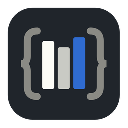
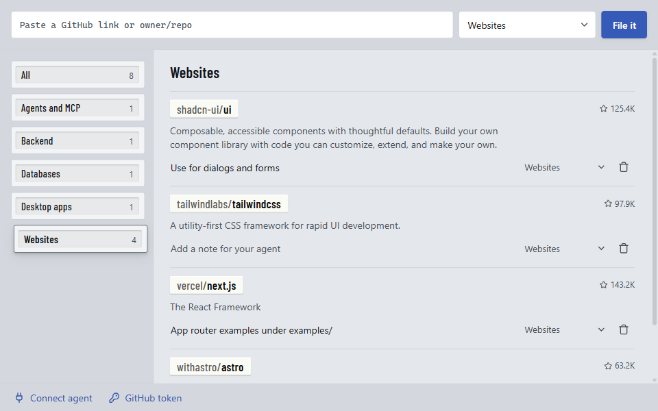

<p align="center">
  
</p>

<h1 align="center">repo-shelf</h1>

<p align="center">
  Keep a shelf of GitHub repos your coding agents can read when a task needs them, without cloning anything.<br/>
  A small desktop app with a built-in MCP server, for Claude Code, Codex, Cursor or any client that speaks MCP over stdio.
</p>

<p align="center">
  <picture>
    <source media="(prefers-color-scheme: dark)" srcset=".github/assets/screenshot-dark.png" />
    
  </picture>
</p>

---

## Why

Good reference code helps an agent. If you want it to build a landing page the way a
repo you like does it, the usual move is to clone that repo into the workspace. Then
it sits on disk, gets indexed, and fills the context with files that have nothing to
do with the task.

repo-shelf keeps the repos on a shelf instead. You paste a link and pick a category.
When the agent starts work on a website, it checks the shelf, finds the repos you
filed under Websites, and reads the files it needs straight from GitHub.

## What it does

- You file repos by category. Any GitHub link works: `owner/repo`, a full URL, a `.git` URL or a `/tree/...` link. The app fetches the description and star count.
- Each repo can carry a one-line note for your agent, like "App router examples under examples/".
- The MCP server has seven tools: `list_categories`, `list_repos`, `search_shelf`, `get_tree`, `read_file`, `search_code` and `add_repo`.
- Files are read from GitHub and cached by commit in the app's data folder. Your project folder stays untouched.
- It is one binary. `repo-shelf` opens the window and `repo-shelf mcp` runs the MCP server over stdio. Both use the same library, so the agent sees whatever you filed in the window.

## Download

Get the installer for your OS from the [Releases](https://github.com/Ramonvdo/repo-shelf/releases) page:

| OS | File |
|---|---|
| Windows | `-setup.exe` (recommended) or `.msi` |
| macOS | `.dmg` (`aarch64` for Apple Silicon, `x64` for Intel) |
| Linux | `.AppImage`, `.deb` or `.rpm` |

> The builds are unsigned, so your OS will warn you the first time you open the app. On
> Windows, click **More info** and then **Run anyway**. On macOS, right-click the app and
> choose **Open**.

## Connect your agent

Open the app and click **Connect agent** in the bottom bar. It shows the exact command for
your install, with a copy button. For Claude Code it looks like this:

```bash
claude mcp add --scope user repo-shelf -- "/path/to/repo-shelf" mcp
```

The same sheet has the snippet for Codex (`~/.codex/config.toml`) and the JSON most other
MCP clients use. You only do this once. Your agent launches `repo-shelf mcp` on its own,
so the window doesn't need to be open.

## GitHub token (optional)

Without a token, GitHub allows 60 API requests an hour, which is fine for light use. A
token raises that to 5,000 and enables `search_code`. A fine-grained token with no extra
permissions is enough for public repos. Add it under **GitHub token** in the bottom bar.

## Where your data lives

The library is a SQLite file in your app-data folder, next to the file cache:

| OS | Folder |
|---|---|
| Windows | `%APPDATA%\repo-shelf` |
| macOS | `~/Library/Application Support/repo-shelf` |
| Linux | `~/.local/share/repo-shelf` |

Set `REPO_SHELF_DIR` to use a different folder.

## Build from source

You need Node 22 or newer, a stable Rust toolchain and the
[Tauri prerequisites](https://v2.tauri.app/start/prerequisites/) for your OS.

```bash
git clone https://github.com/Ramonvdo/repo-shelf.git
cd repo-shelf
npm install
npm run tauri dev                    # run the app in development
npm run tauri build                  # build installers for this OS
cd src-tauri && cargo test           # run the tests
```

`scripts/mcp-smoke.mjs` is a small stdio client for poking at the MCP server by hand:

```bash
node scripts/mcp-smoke.mjs src-tauri/target/release/repo-shelf list_categories '{}'
```

## Releases

Pushing a version tag builds installers for every platform in GitHub Actions and attaches
them to a draft release:

```bash
git tag v0.1.0 && git push origin v0.1.0
```

## Security and license

See [SECURITY.md](SECURITY.md) to report a vulnerability. MIT licensed, see [LICENSE](LICENSE).
